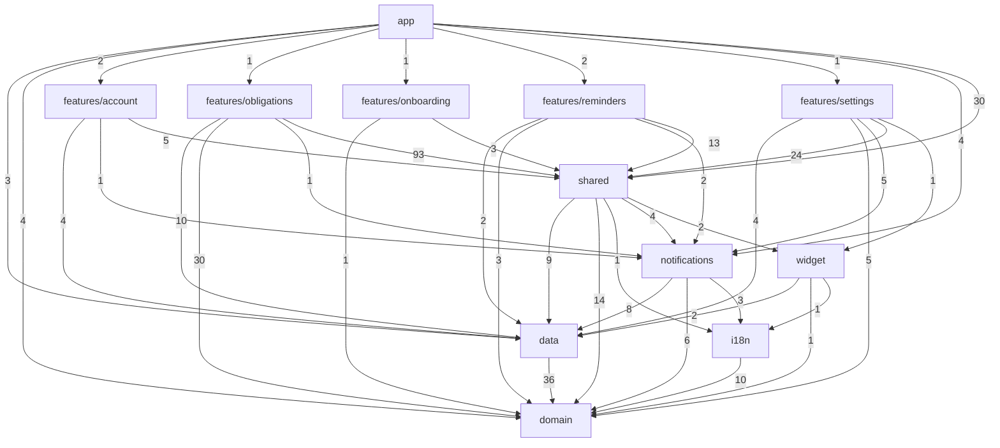

# Harta modulelor

Generat de `npm run deps:map` (dependency-cruiser, nivel de folder). Nu edita de mână.
Săgeata `A --> B` înseamnă „A importă din B”; numărul = importuri între fișiere. Testele sunt excluse.

## Cine importă din cine

- `domain` → (nimic)
- `data` → `domain`
- `i18n` → `domain`
- `notifications` → `data`, `domain`, `i18n`
- `widget` → `data`, `domain`, `i18n`
- `shared` → `data`, `domain`, `i18n`, `notifications`, `widget`
- `app` → `data`, `domain`, `features/account`, `features/obligations`, `features/onboarding`, `features/reminders`, `features/settings`, `notifications`, `shared`
- `features/account` → `data`, `notifications`, `shared`
- `features/obligations` → `data`, `domain`, `notifications`, `shared`
- `features/onboarding` → `domain`, `shared`
- `features/reminders` → `data`, `domain`, `notifications`, `shared`
- `features/settings` → `data`, `domain`, `notifications`, `shared`, `widget`
